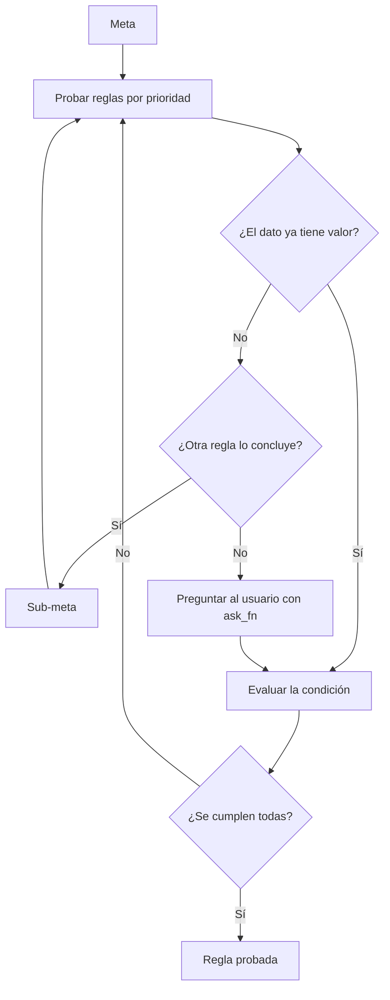

# Documentación del módulo G6: Motor de encadenamiento hacia atrás

Grupo 6 · ES-Shell Suite en Python · Carpeta `grupo_06_backward/`

## Resumen

El módulo del Grupo 6 implementa `BackwardEngine`, el motor de encadenamiento hacia atrás de la ES-Shell Suite: parte de una meta, como `dictamen`, y verifica de forma recursiva qué reglas la prueban, pidiendo al usuario solo los datos que hacen falta. Se entrega en la carpeta `grupo_06_backward/` con código, ejemplo, consola de demostración, README, esta documentación y 96 pruebas que pasan en Python 3.11, 3.12 y 3.13.

El motor trabaja sobre los contratos JSON congelados (`conocimiento_dominio.json` y `memoria_trabajo.json`) y no importa código de otros grupos. En una comparación con el `ForwardEngine` del G5, ambos dan el mismo dictamen y la misma regla en 27 de 27 combinaciones de datos de la base de ejemplo.

## Contexto y alcance

El documento de evaluación asigna al Grupo 6 el encadenamiento hacia atrás (`esb_engine_backward.py`): verificar una meta de forma recursiva y solicitar al usuario solo los datos necesarios. El entregable es la clase `BackwardEngine`. Este motor comparte con G5 y G7 la memoria de trabajo, y con G8 la traza que explica el resultado.

| Requisito (sección 7 de la guía) | Cómo se cumple |
| --- | --- |
| Lenguaje Python | Todo el código está en Python 3.11 o superior |
| Respeto de contratos JSON | Lee `conocimiento_dominio.json` y escribe `memoria_trabajo.json` sin cambiar ningún campo |
| Separar lógica de interfaz | El motor no imprime ni lee la consola; recibe una función `ask_fn` y la consola vive en otro archivo |
| Sin archivo monolítico | Motor, consola, ejemplo y pruebas son archivos separados |
| Pruebas unitarias | 96 pruebas: casos normales, datos inválidos, reglas que no se activan y conflictos |
| Datos ficticios | La base de ejemplo usa datos académicos inventados, sin personas reales |
| Documentación de uso | `README.md` con API, uso, política del motor y comandos de prueba |

Según `CONTRIBUTING.md`, el trabajo se mantiene dentro de la carpeta `grupo_06_backward/` y entra al repositorio central por Pull Request hacia la rama `grupo-06`.

## Entregables

| Archivo | Para qué sirve |
| --- | --- |
| `esb_engine_backward.py` | Clase `BackwardEngine`: el motor, con la validación de la base, la memoria y las respuestas |
| `__init__.py` | API pública del paquete |
| `esb_backward_cli.py` | Consola de demostración: pregunta los datos, muestra el resultado, la traza y el razonamiento |
| `datos_ejemplo/conocimiento_encadenado.json` | Base de conocimiento de ejemplo con 6 reglas y 2 niveles de encadenamiento |
| `README.md` | Documentación de uso del módulo |
| `docs/DOCUMENTACION.md` | Este documento |
| `tests/test_backward.py` | 54 pruebas unitarias del motor |
| `tests/test_cli.py` | 7 pruebas de la consola |
| `tests/test_integracion_g5_g8_g4.py` | 33 pruebas de integración con G5, G8 y G4 |
| `tests/test_integracion_g7.py` | 2 pruebas de integración con G7 y G8 (factores de certeza) |

## Diseño y funcionamiento

El motor trabaja como un detective que parte de la conclusión y busca las pruebas, al revés del G5, que parte de los datos y deduce. Dada una meta, prueba las reglas que la concluyen de mayor a menor prioridad. Cada condición se resuelve según su caso: si el atributo ya tiene valor se evalúa; si otra regla lo concluye se vuelve una sub-meta; y si ninguna regla lo concluye se le pide el dato al usuario.

Solo se pregunta lo necesario porque una regla se descarta apenas una condición ya conocida resulta falsa, antes de pedir el resto de sus datos. Por ejemplo, si el usuario indica "Electiva", la regla de Trabajo de Graduación se descarta sin pedir promedio ni créditos.



Si una condición falla, la regla se descarta y se prueba la siguiente. Si todas se cumplen, la regla queda probada y agrega un hecho derivado.

### Política del motor

1. Las reglas de una meta se prueban de mayor a menor `priority` (empate: por `id`), igual que en G5. Gana la primera que se cumple.
2. Un hecho ya presente, ingresado o derivado, no se sobrescribe.
3. Un atributo que alguna regla concluye se deriva y no se pregunta; uno que ninguna regla concluye se pregunta.
4. Una pregunta con `depends_on` (G1) solo se formula si su condición se cumple.
5. Un ciclo entre reglas se detecta y esa vía se descarta; `max_depth` limita las cadenas muy largas.
6. Una meta que ya falló no se vuelve a explorar en la misma consulta, lo que evita repetir trabajo.
7. Una comparación imposible, como `>` entre texto y número, cuenta como condición falsa, igual que en G5.
8. Cada regla probada agrega un hecho a `derived_facts` y un paso a `execution_trace`, en orden de derivación: primero las sub-metas.

### Ejemplo trazado

Estudiante de Trabajo de Graduación con promedio 2,5 y 150 créditos. El atributo `requisitos` no se pregunta: lo concluye la regla `rule_04` a partir de los créditos. Esta es la salida real de `BackwardResult.proof`:

```text
Meta: dictamen
Probando rule_01 para concluir 'dictamen' (Trabajo de Graduación con promedio y créditos suficientes)
  Dato ingresado: materia = 'Trabajo de Graduacion'
  Cumple: materia == 'Trabajo de Graduacion' (valor: 'Trabajo de Graduacion')
  Dato ingresado: promedio = 2.5
  Cumple: promedio >= 2.0 (valor: 2.5)
  Probando rule_04 para concluir 'requisitos' (Créditos suficientes)
    Dato ingresado: creditos = 150
    Cumple: creditos >= 140 (valor: 150)
  rule_04 probada: requisitos = 'Cumple'
  Cumple: requisitos == 'Cumple' (valor: 'Cumple')
rule_01 probada: dictamen = 'Elegible'
```

La traza resultante en `memoria_trabajo.json` tiene dos pasos, `rule_04` (agrega `requisitos`) y luego `rule_01` (agrega `dictamen`).

## API pública

La clase `BackwardEngine` recibe la base de conocimiento ya cargada como `dict` y expone cuatro métodos. Las firmas son propuestas hasta que los coordinadores las acepten.

| Método | Qué hace | Devuelve |
| --- | --- | --- |
| `BackwardEngine(knowledge_base, ask_fn=None, *, max_depth=100)` | Crea el motor y valida la base | instancia |
| `prove(goal_attribute, goal_value=None, memory=None, *, session_id=None)` | Verifica una meta; con `goal_value` comprueba una hipótesis | `BackwardResult` |
| `next_question(goal_attribute, memory=None, goal_value=None)` | Indica el próximo dato que haría falta, sin preguntar | `Question` o `None` |
| `validate_answer(attribute_id, value)` | Valida y normaliza una respuesta (acepta `"2,25"` como 2.25) | valor o `InvalidAnswerError` |

`ask_fn(question)` es la función que la interfaz aporta para pedir un dato: devuelve el valor ingresado, o `None` si el usuario no lo sabe. Sin `ask_fn` el motor no pregunta y devuelve el primer dato faltante, que es el modo que necesita una API sin estado.

### Question: el dato que el motor necesita

| Campo | Contenido |
| --- | --- |
| `attribute_id`, `question`, `type`, `options`, `range` | Tomados de `attributes[]` de la base |
| `rule_id` | Regla que el motor evalúa al pedir el dato; es lo que G8 usa para el WHY |
| `goal` | Atributo que esa regla concluiría |

### BackwardResult: el resultado de `prove`

| Campo | Contenido |
| --- | --- |
| `achieved`, `value` | Si se alcanzó la meta y el valor del atributo |
| `reason` | `derivado`, `dato_conocido`, `valor_distinto`, `no_se_cumple_ninguna_regla`, `sin_conclusion` o `falta_dato` |
| `memory` | `memoria_trabajo.json` actualizado; la memoria recibida no se modifica |
| `fired_rules` | Reglas probadas, en orden de derivación |
| `questions_asked` | Preguntas formuladas, en orden |
| `pending_question` | Con `ask_fn=None`, el primer dato que falta |
| `proof` | Razonamiento paso a paso, en texto |

Los errores son subclases de `BackwardEngineError` (`ValueError`) con mensajes en español: `InvalidKnowledgeBaseError`, `InvalidWorkingMemoryError` e `InvalidAnswerError`.

## Integración con los demás grupos

El motor no importa código de otros grupos: se comunica únicamente por los contratos JSON. La tabla indica qué recibe cada grupo del G6 y qué necesita el G6 de él.

| Grupo | Relación con G6 | Estado |
| --- | --- | --- |
| G1, G2, G4 | G6 lee `attributes[]` y `rules[]` según los contratos para formular preguntas y evaluar reglas | Probado con la validación de G4 |
| G5 | Comparten la memoria de trabajo y la política de prioridades. Dan el mismo dictamen en las 27 combinaciones probadas | Probado, con una diferencia conocida (ver Decisiones) |
| G7 | Recibe `memory` con `certainty_factor` en 1.0 en cada hecho derivado y puede recalcularlo con `evaluate()` | Probado con el UncertaintyEngine real |
| G8 | Recibe `memory` y `Question.rule_id`; con eso arma el HOW (`explain_how`) y el WHY (`explain_why(q.attribute_id, q.rule_id)`) | Probado con el `XAIExplainer` real |
| G9 | Recibe `memory` y `fired_rules` para el reporte | Sin probar; hoy es un esqueleto sin implementar |
| G10 | Usa `ask_fn`, `Question` y `validate_answer` para la consulta interactiva | Sin código en el repositorio todavía |
| G12 | Usa `prove` y `next_question` para el motor `atras`, que hoy simula con el hacia adelante | Pendiente de conectar; el README incluye el código |

Para conectar el motor en la API, G12 solo agrega una función de carga y dos métodos en `adaptadores.py`, sin tocar `servicio.py`. El código exacto está en el README del módulo.

## Pruebas y resultados

Las 96 pruebas pasan en Python 3.11, 3.12 y 3.13; las dos primeras son las que usa el flujo de integración del repositorio. En la suite completa del repositorio pasan 428 pruebas, sin contar `grupo_12_api`, que no se pudo ejecutar porque `fastapi` no estaba instalado en el entorno de prueba.

| Archivo | Pruebas | Qué cubre |
| --- | --- | --- |
| `test_backward.py` | 54 | Ejemplo de la sección 4.2, sub-metas encadenadas, preguntas solo cuando hacen falta, hipótesis confirmada y refutada, conflictos por prioridad y por `id`, ciclos, datos desconocidos, preguntas condicionales, respuestas inválidas, bases y memorias inválidas, profundidad máxima y rendimiento |
| `test_cli.py` | 7 | Consulta completa, `?` para el WHY, respuesta inválida, "no sé", hipótesis, archivo inexistente y meta inexistente |
| `test_integracion_g5_g8_g4.py` | 33 | Comparación con `ForwardEngine` en 27 combinaciones, HOW y WHY con `XAIExplainer`, validación de contratos con `SchemaManager` y la diferencia conocida con G5 |
| `test_integracion_g7.py` | 2 | Factores de certeza de `UncertaintyEngine` sobre la memoria de G6 y su aparición en el HOW |

### Qué se verificó con los otros módulos

- **G5:** con la misma base y los mismos datos, ambos motores dan el mismo dictamen y la misma regla en las 27 combinaciones de materia, promedio y créditos probadas.
- **G8:** `explain_how` reconstruye la cadena completa, con `rule_04` anidada bajo `rule_01`, y `explain_why` responde cada pregunta citando la regla que informa G6.
- **G4:** `SchemaManager.validar_conjunto` acepta la base, la memoria, la traza y un dictamen armado con los datos de G6.
- **G7:** con las certezas de prueba, `requisitos` queda en 0,9 y `dictamen` en 0,72, y el HOW de G8 lo muestra como `FC = 0.72`.

### Defectos encontrados y corregidos en la revisión

Después de la primera versión se hizo una auditoría del módulo y se corrigieron tres fallos reales.

- **Ejemplo del README:** se caía con un error si el usuario escribía mal un dato; ahora vuelve a preguntar.
- **Rendimiento:** con reglas repetidas en 18 niveles el motor generaba 2,3 millones de líneas de razonamiento; ahora no repite las metas que ya fallaron y la misma prueba genera menos de 500 líneas.
- **Memoria mal formada:** un hecho derivado sin campo `value` producía un `KeyError`; ahora da un error claro en español.

## Escenario de demostración obligatorio

Con su consola de demostración, el módulo cubre por sí solo siete de los ocho pasos de la sección 6 de la guía; el dictamen en formato `dictamen_salida.json` y el reporte dependen de G9 y G12.

| Paso de la guía | Cómo lo cubre G6 | Cómo mostrarlo |
| --- | --- | --- |
| Cargar la base desde `conocimiento_dominio.json` | La consola lee el archivo y crea el `BackwardEngine` | Ejecutar la consola con la ruta de la base |
| Iniciar una consulta y pedir los datos | El motor llama a `ask_fn` solo para los datos necesarios | La consola pregunta materia, promedio y créditos |
| Registrar los datos en la memoria de trabajo | Cada respuesta válida se guarda en `memory["facts"]` | Opción `--salida memoria.json` |
| Activar reglas y generar un hecho derivado | `prove` deriva `requisitos` y `dictamen` | Pantalla de resultado |
| Mostrar la traza de reglas aplicadas | `execution_trace` en orden de derivación | Pasos 1 y 2 en pantalla; razonamiento completo con `--razonamiento` |
| Responder una pregunta HOW y una WHY | WHY: `?` en cualquier pregunta; HOW: `explain_how` de G8 sobre la memoria | Escribir `?` en la consola |
| Presentar el dictamen final y exportar un reporte | G6 entrega el valor y la memoria; G9 y G12 arman el dictamen y el reporte | Depende de esos grupos |
| Una prueba que valide el resultado esperado | `pytest` con el caso documentado de la sección 4.2 | `python -m pytest grupo_06_backward -v` |

Comandos desde la raíz del repositorio:

```bash
# Consulta interactiva (escribir ? para ver el WHY; Enter si no se sabe)
python -m grupo_06_backward.esb_backward_cli grupo_06_backward/datos_ejemplo/conocimiento_encadenado.json --razonamiento --salida memoria.json

# Comprobar una hipótesis
python -m grupo_06_backward.esb_backward_cli grupo_06_backward/datos_ejemplo/conocimiento_encadenado.json --valor Elegible

# Pruebas
python -m pytest grupo_06_backward -v
```

## Decisiones de diseño y limitaciones

La decisión con más impacto es la política de prioridades, que el G6 tomó por su cuenta y que aún no se ha acordado con el G5.

### Diferencia conocida con G5

G5 dispara siempre la regla de mayor prioridad entre todas las activables; G6 prueba por meta, de mayor a menor prioridad. Si una regla de baja prioridad ya es activable y la de alta prioridad necesita antes un hecho derivado, G5 dispara primero la de baja y la de alta ya no puede sobrescribirla (primera aserción gana), mientras que G6 llega a la de alta. No ocurre cuando las reglas de una misma meta son mutuamente excluyentes, como en la base de ejemplo. Está documentado con la prueba `test_diferencia_conocida_con_g5_en_prioridades_entre_niveles`.

### Otras decisiones

- **Memoria como `dict`:** el motor usa diccionarios con la forma de los contratos, igual que G7 y G8, para no depender del código de otro grupo.
- **Un atributo que alguna regla concluye no se pregunta:** coincide con lo que ya hace la API de G12. Si ninguna regla lo prueba, la meta queda sin concluir.
- **Respuestas inválidas:** el motor lanza `InvalidAnswerError`; es la interfaz quien vuelve a preguntar, con ayuda de `validate_answer`.
- **`certainty_factor` en 1,0:** G6 no calcula certeza; la deja en 1,0 y G7 la recalcula.

### Limitaciones

- `explanation_why` del contrato es una sola cadena, pero este motor puede hacer varias preguntas; cada `Question` trae su regla y quien arma el dictamen decide cuál explicar.
- `execution_trace` no guarda las premisas ni las preguntas; ese detalle está en `BackwardResult.proof`, que no forma parte de ningún contrato.
- No se ha probado con G10 ni con G11, porque sus carpetas están vacías, ni con G9, que es un esqueleto.
- Las pruebas de G12 no se ejecutaron en el entorno de desarrollo; el motor tampoco está conectado a su API todavía.

## Pendientes y próximos pasos

- [ ] Acordar con el G5 la política de prioridades, para que ambos motores coincidan en el caso límite documentado.
- [ ] Subir la carpeta `grupo_06_backward/` por Pull Request hacia la rama `grupo-06`, después de correr `python -m pytest grupo_06_backward -v`.
- [ ] Entregar al G12 el código de conexión del README para que su motor `atras` deje de usar el motor hacia adelante.
- [ ] Acordar con el G10 la firma de `ask_fn`, `Question` y `validate_answer` para la consulta interactiva.
- [ ] Acordar con el G8 que el WHY use `Question.rule_id`, y con el G9 qué campos de `memory` necesita el reporte.
- [ ] Confirmar el nombre del coordinador que aparece en el README del módulo.
- [ ] Que cada integrante del grupo lea el motor y pueda explicarlo; el núcleo está en `_derive`, `_try_rule` y `_ask`.
